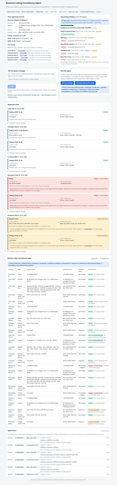
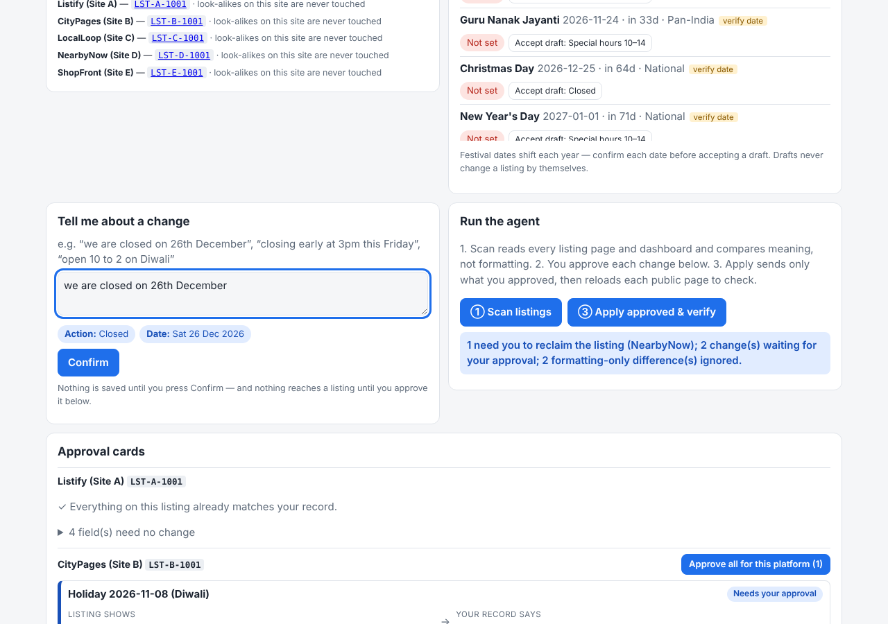
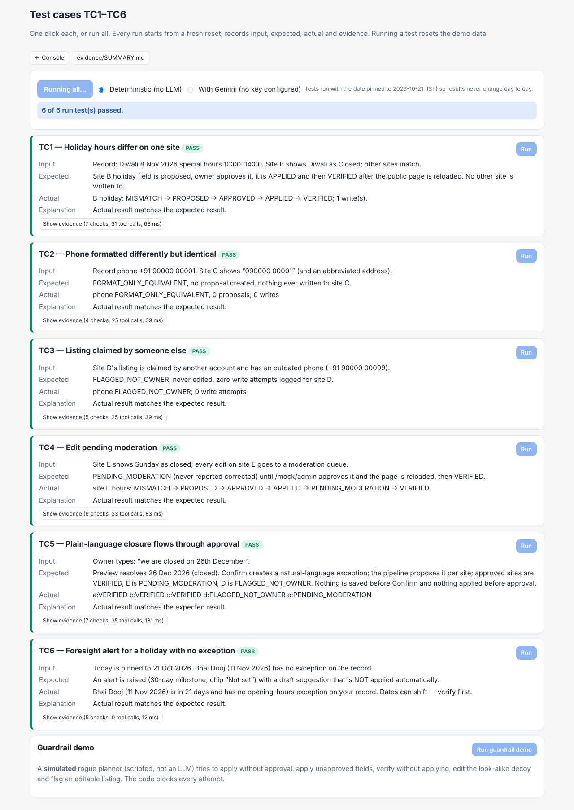
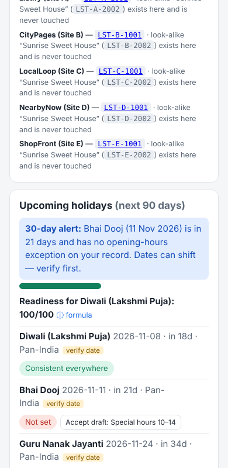

# Business Listing Consistency Agent

An agent that keeps a local business's **address, phone and hours** consistent across listing sites — and **asks for your approval before changing anything**. Built for the Agentic AI Hackathon 2026 (Ziro.Digital), industry *Business & Productivity AI*. **Mock listing sites and synthetic data only** (fictional "Sunrise Sweets & Bakery", Pune).



## What it does

1. You keep one owner-approved record (address, phone, normal hours, holiday exceptions, stable IDs).
2. The agent **reads** five mock listing sites (public page + owner dashboard), keeps the **raw and normalised** values side by side, and **compares meaning, not formatting** (`090000 00001` = `+91 90000 00001`).
3. Every real difference becomes an **approval card** (approve / reject per field per platform, or "approve all for this platform").
4. Only approved changes are sent (idempotent). The agent then **reloads the public page** and verifies. Listings claimed by someone else are **flagged, never edited**; edits waiting in a moderation queue are reported **PENDING**, never as corrected.
5. You get a **before/after table** (CSV + printable) with: platform, field, original value, intended value, approval status, verified status.
6. Extras: **Holiday Foresight** (90-day look-ahead, alerts at 30/14/7 days, readiness score) and **plain-language closures** ("we are closed on 26th December").

| Live preview of a plain-language change | Tests page (TC1–TC6) | Phone |
|---|---|---|
|  |  |  |

The agent works with **no API key** (deterministic planner). With `GEMINI_API_KEY` set, Gemini picks each next tool through the Interactions API; code-level guardrails still block anything unsafe, and any failure falls back to the deterministic planner (all visible in the agent trace).

---

## Run it on Windows (PowerShell, beginner steps)

**1. Install Node 22 LTS and Git** (one time). In PowerShell:
```powershell
winget install OpenJS.NodeJS.LTS
winget install Git.Git
```
Close and reopen PowerShell, then check: `node -v` (should start with `v22`).

**2. Get the code and install**
```powershell
git clone https://github.com/yourgrok/zirohacksub.git
cd zirohacksub
git checkout claude/determined-goldberg-qj02eh
npm install
```
*(If `better-sqlite3` fails to build, nothing to do: the app automatically falls back to Node's built-in `node:sqlite`.)*

**3. Create your `.env`** (the key never goes in chat or git)
```powershell
Copy-Item .env.example .env
notepad .env
```
Paste your key after `GEMINI_API_KEY=` and save. No key? Leave it empty (or set `LLM_PROVIDER=none`) — everything still works.

**4. Run locally**
```powershell
npm run build
npm start
```
Open <http://localhost:3000>. (For development with hot reload: `npm run dev`, then open <http://localhost:5173>.)

**5. Run the tests**
```powershell
npm run typecheck
npm test                 # unit + integration tests
npm run test:tc          # TC1-TC6, deterministic, writes evidence/ (no LLM, never flaky)
npm run test:tc:llm      # TC1-TC6 with Gemini (needs the key in .env), writes evidence/llm/
```
Or open <http://localhost:3000/tests> and press **Run all**.

Optional, for screenshots in `evidence/`: `npx playwright install chromium`, then `$env:READER_MODE="auto"` before `npm run test:tc`.

**6. Check `/health`**
```powershell
Invoke-RestMethod http://localhost:3000/health
```
Shows version, reader mode, planner mode (`gemini`/`deterministic`) and DB status — never the key.

## Put it on GitHub
```powershell
git remote -v            # already points at your repo if you cloned it
git add -A
git commit -m "My changes"
git push -u origin claude/determined-goldberg-qj02eh
```
GitHub will ask you to sign in in the browser the first time (Git Credential Manager).

## Deploy on Render (free web service)
1. Go to <https://render.com> → **New + → Web Service** → connect the GitHub repo → choose branch `claude/determined-goldberg-qj02eh` (or merge to `main` first).
2. **Runtime: Docker** (it finds `Dockerfile`). Instance type: **Free**. (`render.yaml` in the repo describes the same settings if you prefer *New + → Blueprint*.)
3. **Environment → Add Environment Variable:** `GEMINI_API_KEY` = your key (optional). The others default correctly (`READER_MODE=http`, models). Set **Health Check Path** to `/health`.
4. Deploy. When it is live open `https://<your-service>.onrender.com/health` — you should see `"status":"ok"`. Then open the root URL for the console and `/tests` to run all six tests.

> **SQLite on a free host is temporary.** The disk is wiped on restart/redeploy; that is fine because the app **reseeds the demo data on boot** (and "Reset demo data" does it on demand). Free services also sleep when idle, so the first request can take ~30–60 s.
>
> `Dockerfile.playwright` is for hosts with more memory (reads pages in real Chromium, `READER_MODE=auto`). **Neither Dockerfile was built in the authoring environment** (no Docker there) — the app itself was run and tested directly with Node 22.

---

## Rubric → features → files

| Rubric item (points) | Concrete features | Where |
|---|---|---|
| **Problem fit (20)** | All four brief steps: collect record → plan/compare field by field → read dashboards + public pages → correct only approved mismatches; stable business & listing IDs, decoy look-alike, formatting-only ≠ mismatch, holiday ≠ regular hours, per-platform approval, flag-not-owner, PENDING vs corrected, before/after table with the six columns, mock-only data | `src/core/normalise.ts`, `src/agent/compare.ts`, `src/mock/sites.ts`, `src/agent/report.ts`, `docs/SUBMISSION_NOTES.md` |
| **Agentic capability (25)** | Planner + 8-tool registry; deterministic and Gemini planners share it; per-step decisions; visible timestamped trace with decider badges; human-in-the-loop `ask_owner`; guardrails in code; fallback on every LLM failure; idempotent apply, re-verify loop | `src/agent/tools.ts`, `planners.ts`, `geminiPlanner.ts`, `guard.ts`, `loop.ts` |
| **Technical implementation (20)** | TypeScript end to end; Express + React/Vite + SQLite; Zod everywhere; per-field state machine with enforced transitions; Playwright + HTTP readers; Gemini Interactions API with queue/cache/retry/timeout; 100+ automated tests; Docker + `/health`; works without a key | `src/core/states.ts`, `src/agent/llm.ts`, `src/agent/reader.ts`, `tests/`, `Dockerfile` |
| **Innovation (15)** | Holiday Foresight (chips, 30/14/7 alerts, readiness formula, never-auto-applied drafts); plain-language closures with live preview, relative-date resolution, one clarifying question, Gemini cross-check where the owner breaks ties; visible "Blocked by guardrail" proof with a rogue-planner demo | `src/foresight/index.ts`, `src/nl/`, `/tests` page |
| **UX (10)** | One console: record, holidays, change box, run buttons, approval cards, before/after table (CSV/print), trace; distinct colours and plain-English reasons for pending/flagged; responsive (checked at 390 px, no horizontal scroll); accessible labels, focus rings, light/dark | `web/src/App.tsx`, `web/src/styles.css` |
| **Presentation (10)** | Self-contained written evidence (no links needed), real-run evidence with screenshots, Mermaid architecture, slide outline built from run data, honest limitations | `evidence/SUMMARY.md`, `docs/` |

## The five mock sites

| Site | Condition | Test |
|---|---|---|
| A Listify | everything matches (control) | — |
| B CityPages | Diwali shown as *Closed* instead of 10:00–14:00 | TC1 |
| C LocalLoop | same phone/address, different formatting | TC2 |
| D NearbyNow | claimed by another account; edits return permission-denied; stale phone | TC3 |
| E ShopFront | every edit goes to a moderation queue (`/mock/admin`) | TC4 |

Every site also lists a look-alike business, *Sunrise Sweet House* (different ID, address, phone) that the agent must never touch.

## Official test cases

| | Scenario | Pass condition |
|---|---|---|
| TC1 | holiday hours differ on one site | proposed → approved → APPLIED → VERIFIED after reload |
| TC2 | phone formatted differently | FORMAT_ONLY_EQUIVALENT, no proposal |
| TC3 | claimed by someone else | FLAGGED_NOT_OWNER, zero write attempts |
| TC4 | pending moderation | PENDING_MODERATION → VERIFIED only after /mock/admin approval + reload |
| TC5 | "we are closed on 26th December" | exception created, flows through approval to the sites |
| TC6 | upcoming holiday with no exception | foresight alert raised |

Results of the latest run: [`evidence/SUMMARY.md`](evidence/SUMMARY.md) · details in [`docs/TEST_CASES.md`](docs/TEST_CASES.md).

## Docs
[`docs/ARCHITECTURE.md`](docs/ARCHITECTURE.md) (Mermaid diagrams) · [`docs/CODE_MAP.md`](docs/CODE_MAP.md) · [`docs/TEST_CASES.md`](docs/TEST_CASES.md) · [`docs/SUBMISSION_NOTES.md`](docs/SUBMISSION_NOTES.md) · [`docs/SLIDES.md`](docs/SLIDES.md)

## Configuration
See `.env.example`: `GEMINI_API_KEY`, `GEMINI_MODEL` (default `gemini-3.8-flash`), `GEMINI_FAST_MODEL` (default `gemini-3.5-flash-lite`), `LLM_PROVIDER=gemini|none`, `READER_MODE=playwright|http|auto`, `DEMO_NOW=YYYY-MM-DD` (fixes "today"; the header then says "(demo date)"). All date logic is Asia/Kolkata.

## Honest limitations
Mock sites only · festival dates in `data/holidays.json` are approximate and must be confirmed by the owner ("verify date") · free-host database resets (reseeds on boot) · the LLM is optional and fully guarded · the exact Gemini model names are taken from the brief and could not be checked against Google's docs from the build environment — if a model name is rejected the app tries the other one, then falls back to deterministic · the optional mock-OTP step was not built.
