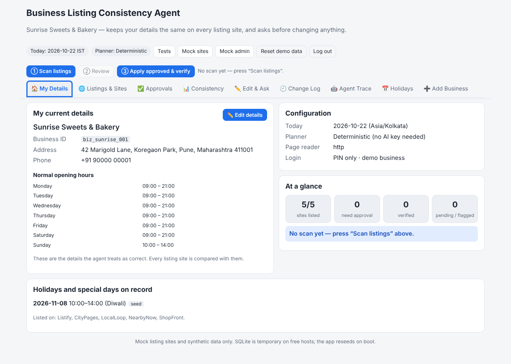
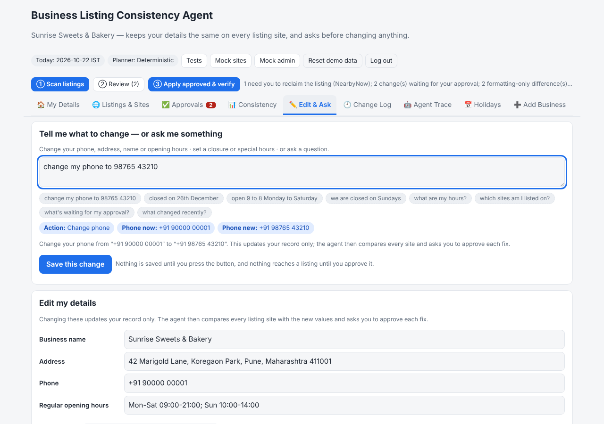
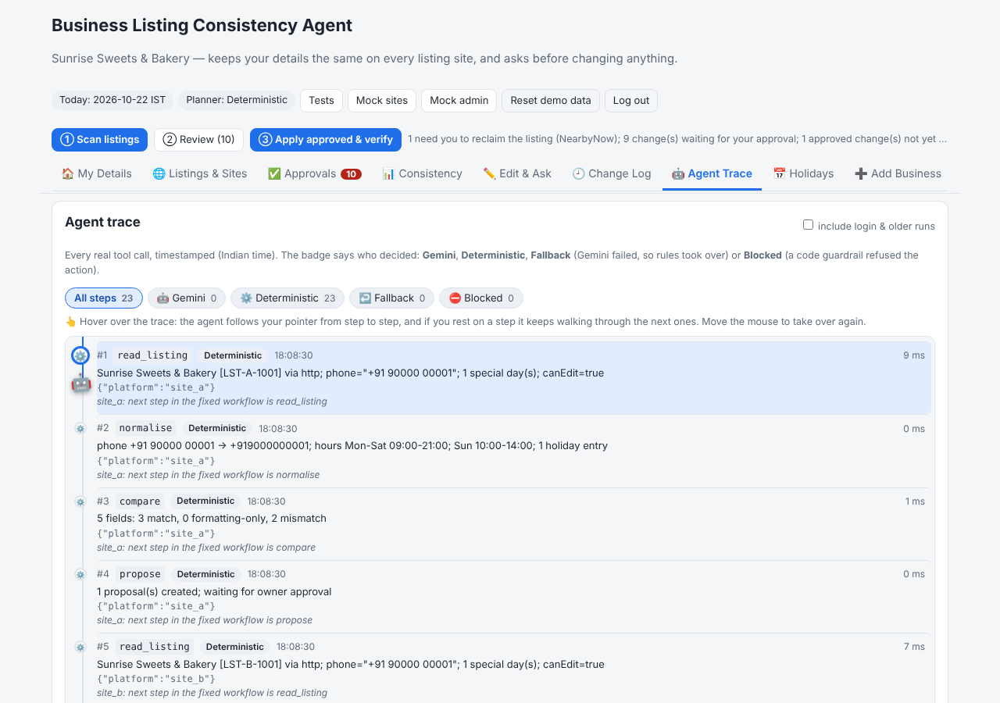
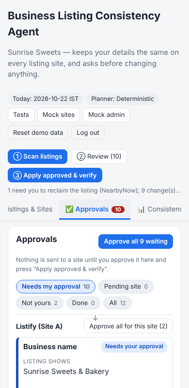

# Business Listing Consistency Agent

An agent that keeps a local business's **address, phone and hours** consistent across listing sites — and **asks for your approval before changing anything**. Built for the Agentic AI Hackathon 2026 (Ziro.Digital), industry *Business & Productivity AI*. **Mock listing sites and synthetic data only** (fictional "Sunrise Sweets & Bakery", Pune).



## What it does

1. You keep one owner-approved record (address, phone, normal hours, holiday exceptions, stable IDs).
2. The agent **reads** five mock listing sites (public page + owner dashboard), keeps the **raw and normalised** values side by side, and **compares meaning, not formatting** (`090000 00001` = `+91 90000 00001`).
3. Every real difference becomes an **approval card** (approve / reject per field per platform, or "approve all for this platform").
4. Only approved changes are sent (idempotent). The agent then **reloads the public page** and verifies. Listings claimed by someone else are **flagged, never edited**; edits waiting in a moderation queue are reported **PENDING**, never as corrected.
5. You get a **before/after table** (CSV + printable) with: platform, field, original value, intended value, approval status, verified status.
6. **New owners** log in with a PIN only (no username, no password). A new owner types their details, the agent finds their listings on every site by **score matching**, the owner confirms each match, and a **view-once PIN** is issued. Sites where the business is not listed can be added with the same approve → apply → verify safety.
7. Extras: **Holiday Foresight** (90-day look-ahead, alerts at 30/14/7 days, readiness score) and **plain-language closures** ("we are closed on 26th December").

| Edit & Ask | Agent Trace | Phone |
|---|---|---|
|  |  |  |

The agent works with **no API key** (deterministic planner). With `GEMINI_API_KEY` set, Gemini picks each next tool through the Interactions API; code-level guardrails still block anything unsafe, and any failure falls back to the deterministic planner (all visible in the agent trace).

---

## Run it on Windows (PowerShell, beginner steps)

**1. Install Node 22 LTS and Git** (one time). In PowerShell:
```powershell
winget install OpenJS.NodeJS.LTS
winget install Git.Git
```
Close and reopen PowerShell, then check: `node -v` (should start with `v22`).

**2. Get the code and install**
```powershell
git clone https://github.com/yourgrok/zirohacksub.git
cd zirohacksub
git checkout claude/determined-goldberg-qj02eh
npm install
```
*(If `better-sqlite3` fails to build, nothing to do: the app automatically falls back to Node's built-in `node:sqlite`.)*

**3. Create your `.env`** (the key never goes in chat or git)
```powershell
Copy-Item .env.example .env
notepad .env
```
Paste your key after `GEMINI_API_KEY=` and save. No key? Leave it empty (or set `LLM_PROVIDER=none`) — everything still works.

**4. Run locally**
```powershell
npm run build
npm start
```
Open <http://localhost:3000> and log in with the **demo PIN `7KQ4X-M9PHT`** (synthetic, public on purpose; it belongs to the seeded demo business). (For development with hot reload: `npm run dev`, then open <http://localhost:5173>.)

**5. Run the tests**
```powershell
npm run typecheck
npm test                 # unit + integration tests
npm run test:tc          # TC1-TC6, deterministic, writes evidence/ (no LLM, never flaky)
npm run test:tc:llm      # TC1-TC6 with Gemini (needs the key in .env), writes evidence/llm/
npm run demo:onboarding  # the whole new-owner journey over real HTTP, then TC1-TC6 again -> evidence/onboarding-demo.md
```
Or log in with the demo PIN, open <http://localhost:3000/tests> and press **Run all** (only the demo business can open that page, because it resets the shared demo data).

Optional, for screenshots in `evidence/`: `npx playwright install chromium`, then `$env:READER_MODE="auto"` before `npm run test:tc`.

**6. Check `/health`**
```powershell
Invoke-RestMethod http://localhost:3000/health
```
Shows version, reader mode, planner mode (`gemini`/`deterministic`) and DB status — never the key.

## Put it on GitHub
```powershell
git remote -v            # already points at your repo if you cloned it
git add -A
git commit -m "My changes"
git push -u origin claude/determined-goldberg-qj02eh
```
GitHub will ask you to sign in in the browser the first time (Git Credential Manager).

## Deploy on Render (free web service)
1. Go to <https://render.com> → **New + → Web Service** → connect the GitHub repo → choose branch `claude/determined-goldberg-qj02eh` (or merge to `main` first).
2. **Runtime: Docker** (it finds `Dockerfile`). Instance type: **Free**. (`render.yaml` in the repo describes the same settings if you prefer *New + → Blueprint*.)
3. **Environment → Add Environment Variable:** `PIN_SECRET` = a long random string (click **Generate** if offered; a blueprint creates it for you), and `GEMINI_API_KEY` = your key (optional). The others default correctly (`READER_MODE=http`, models). Set **Health Check Path** to `/health`.
4. Deploy. When it is live open `https://<your-service>.onrender.com/health` — you should see `"status":"ok"`. Then open the root URL for the console and `/tests` to run all six tests.

> **Businesses created through "Set up my business" are lost whenever a free service restarts or sleeps** (their PINs then stop working; the seeded demo PIN `7KQ4X-M9PHT` always works). Keeping them would need a paid persistent disk or a hosted database.
>
> **SQLite on a free host is temporary.** The disk is wiped on restart/redeploy; that is fine because the app **reseeds the demo data on boot** (and "Reset demo data" does it on demand). Free services also sleep when idle, so the first request can take ~30–60 s.
>
> `Dockerfile.playwright` is for hosts with more memory (reads pages in real Chromium, `READER_MODE=auto`). **Neither Dockerfile was built in the authoring environment** (no Docker there) — the app itself was run and tested directly with Node 22.

---

## Rubric → features → files

| Rubric item (points) | Concrete features | Where |
|---|---|---|
| **Problem fit (20)** | All four brief steps: collect record → plan/compare field by field → read dashboards + public pages → correct only approved mismatches; stable business & listing IDs, decoy look-alike, formatting-only ≠ mismatch, holiday ≠ regular hours, per-platform approval, flag-not-owner, PENDING vs corrected, before/after table with the six columns, mock-only data | `src/core/normalise.ts`, `src/agent/compare.ts`, `src/mock/sites.ts`, `src/agent/report.ts`, `docs/SUBMISSION_NOTES.md` |
| **Agentic capability (25)** | Planner + 8-tool registry; deterministic and Gemini planners share it; per-step decisions; visible timestamped trace with decider badges; human-in-the-loop `ask_owner`; guardrails in code; fallback on every LLM failure; idempotent apply, re-verify loop | `src/agent/tools.ts`, `planners.ts`, `geminiPlanner.ts`, `guard.ts`, `loop.ts` |
| **Technical implementation (20)** | TypeScript end to end; Express + React/Vite + SQLite; Zod everywhere; per-field state machine with enforced transitions; Playwright + HTTP readers; Gemini Interactions API with queue/cache/retry/timeout; 100+ automated tests; Docker + `/health`; works without a key | `src/core/states.ts`, `src/agent/llm.ts`, `src/agent/reader.ts`, `tests/`, `Dockerfile` |
| **Innovation (15)** | Holiday Foresight (chips, 30/14/7 alerts, readiness formula, never-auto-applied drafts); plain-language closures with live preview, relative-date resolution, one clarifying question, Gemini cross-check where the owner breaks ties; visible "Blocked by guardrail" proof with a rogue-planner demo | `src/foresight/index.ts`, `src/nl/`, `/tests` page |
| **UX (10)** | One console: record, holidays, change box, run buttons, approval cards, before/after table (CSV/print), trace; distinct colours and plain-English reasons for pending/flagged; responsive (checked at 390 px, no horizontal scroll); accessible labels, focus rings, light/dark | `web/src/App.tsx`, `web/src/styles.css` |
| **Presentation (10)** | Self-contained written evidence (no links needed), real-run evidence with screenshots, Mermaid architecture, slide outline built from run data, honest limitations | `evidence/SUMMARY.md`, `docs/` |

## The console: nine tabs

A sticky bar on every tab holds the three steps (**① Scan listings → ② Review → ③ Apply approved & verify**). Tabs open directly by click, keyboard (← → Home End) or link (`/#/approvals`, `/#/trace`, …).

| Tab | What you do there |
|---|---|
| 🏠 **My Details** | See your current name, address, phone, weekly hours, saved holidays, settings, and an at-a-glance count of sites, approvals and verified fields |
| 🌐 **Listings & Sites** | One row per site: listed or not, listing ID, how it was linked (score), per-site check counts, **Add my business here** where you are missing |
| ✅ **Approvals** | Approve or reject each proposed fix (filters: needs approval / pending site / not yours / done), **Approve all** per site or overall; the badge shows how many are waiting |
| 📊 **Consistency** | The compact before / after table (site, field, original, intended, approval, verified), filters, CSV export and a printable view |
| ✏️ **Edit & Ask** | The smart text box, a plain edit form for name / address / phone / hours, and cancel buttons for saved holidays |
| 🕘 **Change Log** | What changed, who did it and when (Indian time): detail edits (from → to), holidays, approvals, what was sent to which site, what was verified |
| 🤖 **Agent Trace** | Every real tool call with its decider badge. Hover: a small 🤖 follows your pointer from step to step, and if you rest on a step it keeps walking through the next ones |
| 📅 **Holidays** | Upcoming holidays with chips, 30/14/7-day alerts, readiness score, drafts |
| ➕ **Add Business** | Set up another business (details → "Is this you?" → view-once PIN); you are switched to it, and each business has its own PIN and data |

### The text box (Edit & Ask)

One box understands three kinds of request. Nothing is saved until you press the button, and nothing reaches a listing site until you approve it.

| You type | What happens |
|---|---|
| `change my phone to 98765 43210` · `our address is 12 MG Road, Pune 411001` · `rename the shop to Sunrise Sweets` | A preview (old → new). **Save this change** updates your record (and the change log); a scan then offers an approval card on every site. Approvals you gave for the *old* value go back to review, so the old value is never sent |
| `open 9 to 8 Monday to Saturday` · `we are closed on Sundays` · `we close at 8pm on weekdays` | Changes your **weekly** hours the same way |
| `closed on 26th December` · `open 10 to 2 on Diwali` · `closing early at 3pm this Friday` · `ignore that, we are open on the 26th` | Closures / special hours for dates (as before; Gemini double-checks these when a key is set) |
| `what are my hours?` · `which sites am I listed on?` · `what's waiting for my approval?` · `what changed recently?` · `what holidays are coming up?` · `how am I doing?` | **Answers** from your own data, with a link to the right tab. Read-only; never sent to a model; it never reveals a PIN |
| anything else | One short question listing what it can do |

The business **name** is now a compared field too, so a rename is proposed, approved and verified on every site like phone, address and hours.

## Login: PIN only

- There is **no username and no password**: a business logs in with one PIN, which maps internally to its business uid. After login everything (record, listings, approvals, report, trace) is scoped to that uid; another business's data cannot be read or changed (tested: wrong-business approvals return 404).
- PINs are **system-generated**: 10 characters from a 32-character alphabet without `0 O 1 I`, drawn from a CSPRNG (`crypto.randomInt`), ~50 bits of entropy. Shown as `XXXXX-XXXXX`; case, spaces and dashes are ignored when typing.
- **Never stored in plain text.** The database keeps `HMAC-SHA256(PIN_SECRET, PIN)`, which is also the lookup key (so no username is needed). The match is re-checked with a constant-time comparison.
- **Rate limit:** 5 wrong PINs per client IP, then a 60 s cool-down that doubles on each further lock-out (max 15 min). Every failure gets the same message: "Invalid PIN."
- **Session:** a random 256-bit id in an `httpOnly`, `SameSite=Lax` (and `Secure` over HTTPS) cookie; only its SHA-256 is stored; 8-hour lifetime; **Log out** destroys it on the server. State-changing requests from another origin are refused.
- **Demo PIN: `7KQ4X-M9PHT`** (synthetic; it opens the seeded "Sunrise Sweets & Bakery" business so TC1–TC6 and `/tests` keep working). It is re-hashed on every boot, so changing `PIN_SECRET` never locks it out. Only this business can reset the shared data or open `/tests`.
- `PIN_SECRET` (env var) is the server-side HMAC key. Set it on Render (a blueprint generates one). If you leave it empty (the default in `.env.example`) and use a file database, the app generates a random secret **once** and keeps it in `data/.pin_secret` (git-ignored, owner-only), so restarting the server on your PC never invalidates a PIN. Only with an in-memory database, or a disk that cannot be written, is a temporary per-process secret used.
- **When does a PIN stop working?** Reloading the browser, logging out or restarting the server on your PC does *not* invalidate it. It stops working if (1) the business was deleted: on a free host the database is temporary, so businesses created through onboarding vanish whenever the service restarts or sleeps (the seeded demo PIN keeps working because it is re-created on every boot); (2) it was never used within 30 minutes of being issued (the business is discarded and onboarding can be repeated); (3) you changed `PIN_SECRET` after the PIN was issued (the seeded demo PIN is re-hashed on every boot, but other PINs are not); or (4) you reset the demo data.
- The PIN screen cannot be shown again: if you reload it before saving the PIN, the PIN is lost (it is still valid if you wrote it down, but if not, wait 30 minutes or just run onboarding again).
- **Lost PIN = redo onboarding** (v1 limitation): only the HMAC is stored, so nobody, not even an admin, can show it again.

## New owner onboarding (score matching)

1. **Details:** name, address, phone, optional hours (plain text such as `Mon-Sat 9am-9pm; Sun 10am-2pm`).
2. **The agent reads every listing on every site** (including look-alikes) through the normal reader and scores each one 0–100:

   | Field | Weight | How it is compared |
   |---|---|---|
   | Phone | 40 | digits only, `+91`/`0` prefixes stripped; exact match or nothing |
   | Address | 35 | case/punctuation/abbreviation normalised (`Ln`→`lane`, `MH`→`maharashtra`), word-set (Dice) similarity with typo tolerance; matching pincode adds 30% of this field |
   | Name | 25 | accents/`&`/legal words normalised; Jaro-Winkler on the whole name + fuzzy word-set similarity |

   All weights and thresholds are constants in **`src/onboarding/config.ts`** (`WEIGHTS`, `THRESHOLDS`).
3. **Decision per site** (`HIGH = 75`, `LOW = 45`, `MARGIN = 15`):
   - top score ≥ HIGH **and** at least MARGIN ahead of the runner-up → **proposed automatically** (still needs the owner's "Yes, that's me");
   - between LOW and HIGH, or margin too small → the owner **chooses** among the top 3 (or "none of these");
   - below LOW → **"no listing found"** on that site;
   - a good match that **another account already owns** → **flagged**, never linked, with a manual step (the TC3 behaviour). Entering Sunrise's own details therefore cannot take over its listings.
4. **"Is this you?"** shows, per site: listing, ID, score and why (per-field points). Nothing is linked without a confirmation.
5. **View-once PIN:** shown on its own screen with a copy button, a warning and an "I have saved my PIN" checkbox. The business is created *pending*; the **first login activates it** and claims the confirmed listings (a mock claim; real sites verify ownership with an OTP or postcard that only a human may complete). A PIN never used within 30 minutes is discarded, nothing having been claimed, so a lost PIN can simply be redone.
6. **Add missing sites:** the console shows "Listed on: … · Not listed on: …". "Add my business here" creates an approval card that lists the exact fields and destination. Only after approval does the agent create the listing, reload the page and report **VERIFIED**, or **PENDING_MODERATION** on a moderated site (TC4 behaviour). It never creates a listing on a site where a likely match exists that the owner has not resolved (this is re-checked right before sending).

Real scores from the seeded data: Sunrise vs its true listing **100**, vs the look-alike *Sunrise Sweet House* **37.7**; Green Leaf vs its LocalLoop listing (café accent, `St.`, `MH`, `090000 00031`) **100**, vs the look-alike *Green Leaf Cafe & Bakery* **30.6**; a listing with only an old phone number **60** (asks the owner).

### Demo it end to end
```powershell
npm run demo:onboarding     # narrated run + evidence/onboarding-demo.md; also re-runs TC1-TC6
```
or by hand: open the console → **Set up my business** → enter `Green Leaf Cafe` / `8 Lotus Street, Baner, Pune, Maharashtra 411045` / `+91 90000 00031` / `Mon-Sun 8am-10pm` → confirm the two strong matches (Listify, LocalLoop; NearbyNow is flagged as claimed by someone else) → save the PIN → log in → **Add my business here** on CityPages and ShopFront → **Approve all** → **Apply approved & verify** (CityPages is VERIFIED, ShopFront is PENDING until you approve it at `/mock/admin` and press Apply again).

## The five mock sites

| Site | Condition | Test |
|---|---|---|
| A Listify | everything matches (control) | — |
| B CityPages | Diwali shown as *Closed* instead of 10:00–14:00 | TC1 |
| C LocalLoop | same phone/address, different formatting | TC2 |
| D NearbyNow | claimed by another account; edits return permission-denied; stale phone | TC3 |
| E ShopFront | every edit goes to a moderation queue (`/mock/admin`) | TC4 |

The mock sites now need a **server-signed login** for every dashboard read and edit (a stand-in for the owner's delegated login on a real site), so typing an account name into a request no longer works. `/mock/admin` stays open because it plays the site's own moderators.

Every site also lists a look-alike business, *Sunrise Sweet House* (different ID, address, phone) that the agent must never touch.

## Official test cases

| | Scenario | Pass condition |
|---|---|---|
| TC1 | holiday hours differ on one site | proposed → approved → APPLIED → VERIFIED after reload |
| TC2 | phone formatted differently | FORMAT_ONLY_EQUIVALENT, no proposal |
| TC3 | claimed by someone else | FLAGGED_NOT_OWNER, zero write attempts |
| TC4 | pending moderation | PENDING_MODERATION → VERIFIED only after /mock/admin approval + reload |
| TC5 | "we are closed on 26th December" | exception created, flows through approval to the sites |
| TC6 | upcoming holiday with no exception | foresight alert raised |

Results of the latest run: [`evidence/SUMMARY.md`](evidence/SUMMARY.md) · details in [`docs/TEST_CASES.md`](docs/TEST_CASES.md).

## Docs
[`docs/ARCHITECTURE.md`](docs/ARCHITECTURE.md) (Mermaid diagrams) · [`docs/CODE_MAP.md`](docs/CODE_MAP.md) · [`docs/TEST_CASES.md`](docs/TEST_CASES.md) · [`docs/SUBMISSION_NOTES.md`](docs/SUBMISSION_NOTES.md) · [`docs/SLIDES.md`](docs/SLIDES.md)

## Configuration
See `.env.example`: `PIN_SECRET`, `GEMINI_API_KEY`, `GEMINI_MODEL` (default `gemini-3.8-flash`), `GEMINI_FAST_MODEL` (default `gemini-3.5-flash-lite`), `LLM_PROVIDER=gemini|none`, `READER_MODE=playwright|http|auto`, `DEMO_NOW=YYYY-MM-DD` (fixes "today"; the header then says "(demo date)"). All date logic is Asia/Kolkata.

## Honest limitations
Mock sites only · festival dates in `data/holidays.json` are approximate and must be confirmed by the owner ("verify date") · free-host database resets (reseeds on boot) · the LLM is optional and fully guarded · the exact Gemini model names are taken from the brief and could not be checked against Google's docs from the build environment — if a model name is rejected the app tries the other one, then falls back to deterministic · the optional mock-OTP step was not built · claiming an unclaimed listing is a mock (no OTP) · the login rate limiter lives in memory (resets on restart, per instance) · there is no screen to edit a business record after onboarding · `/mock/admin` is deliberately open.
