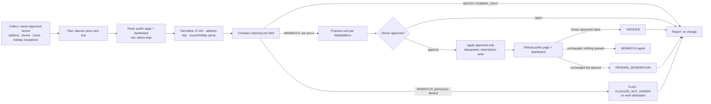
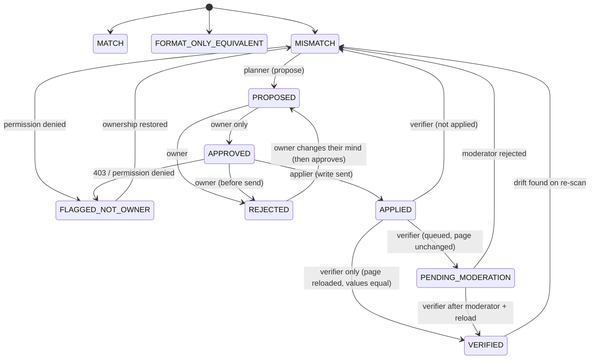
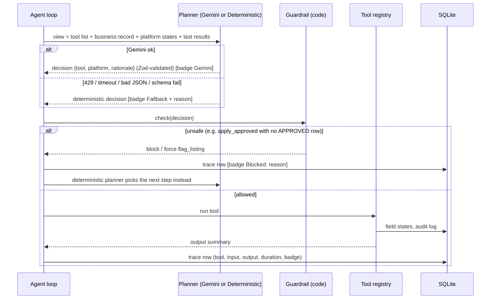
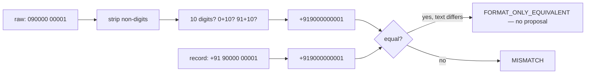
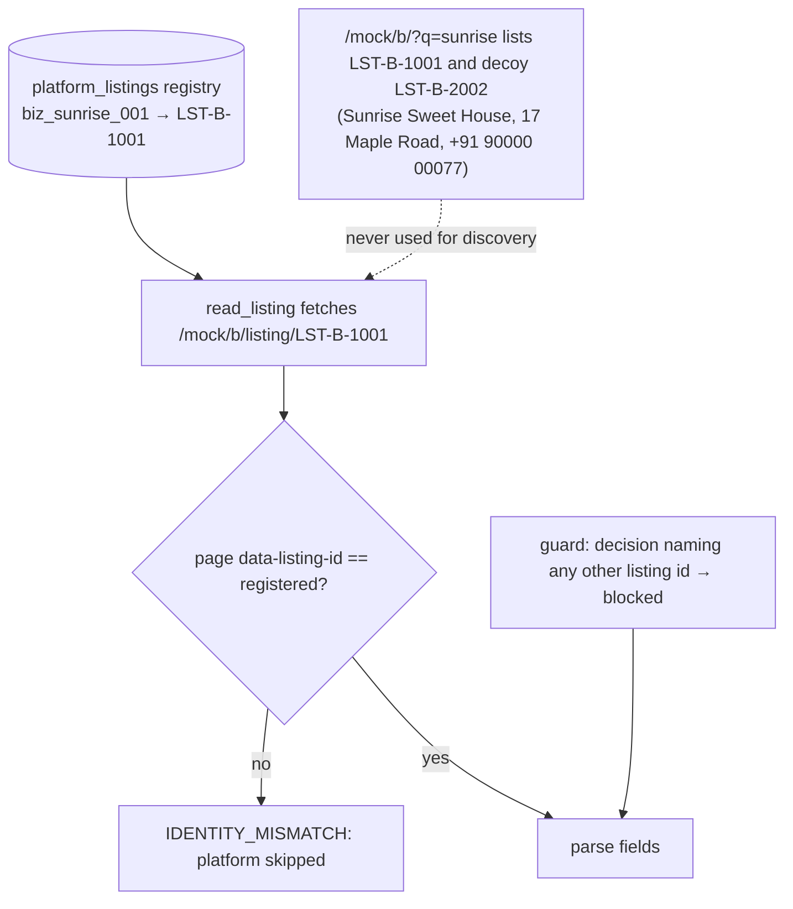
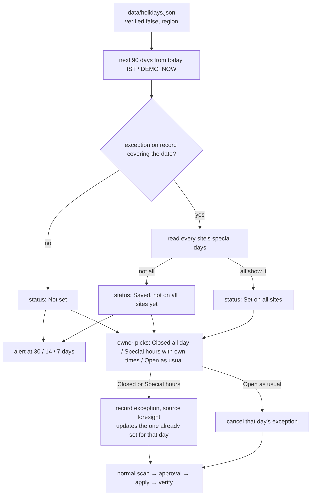
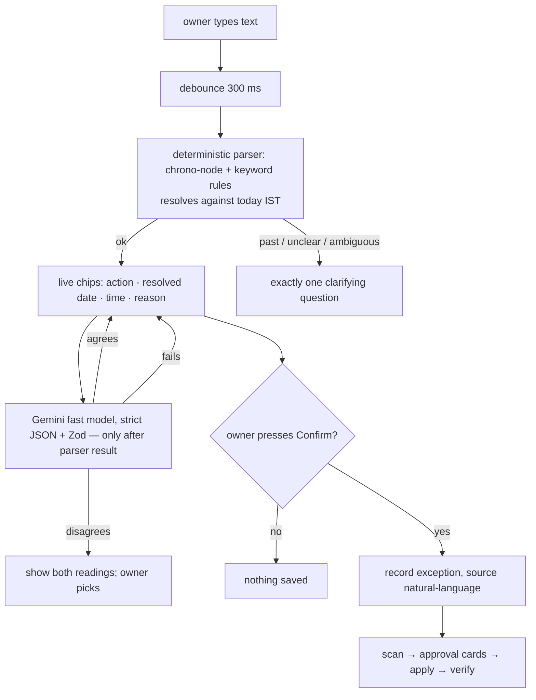
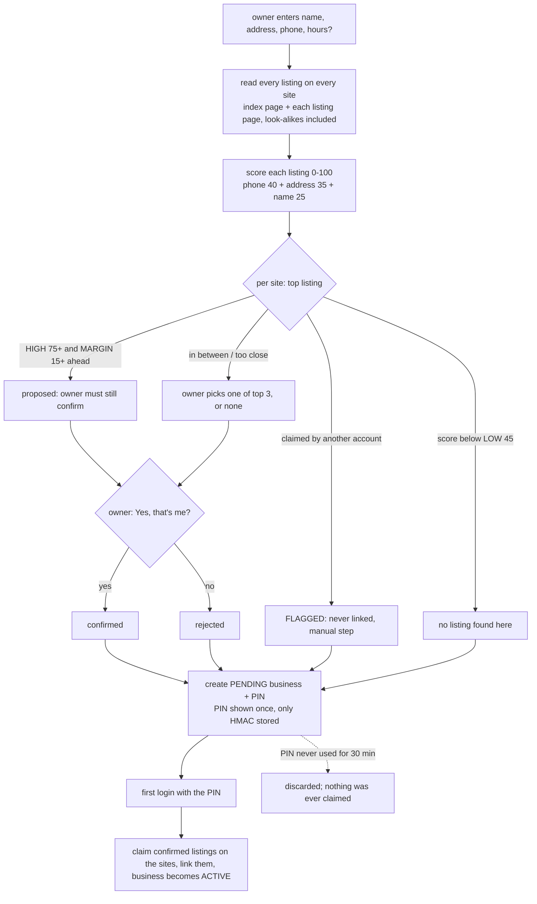
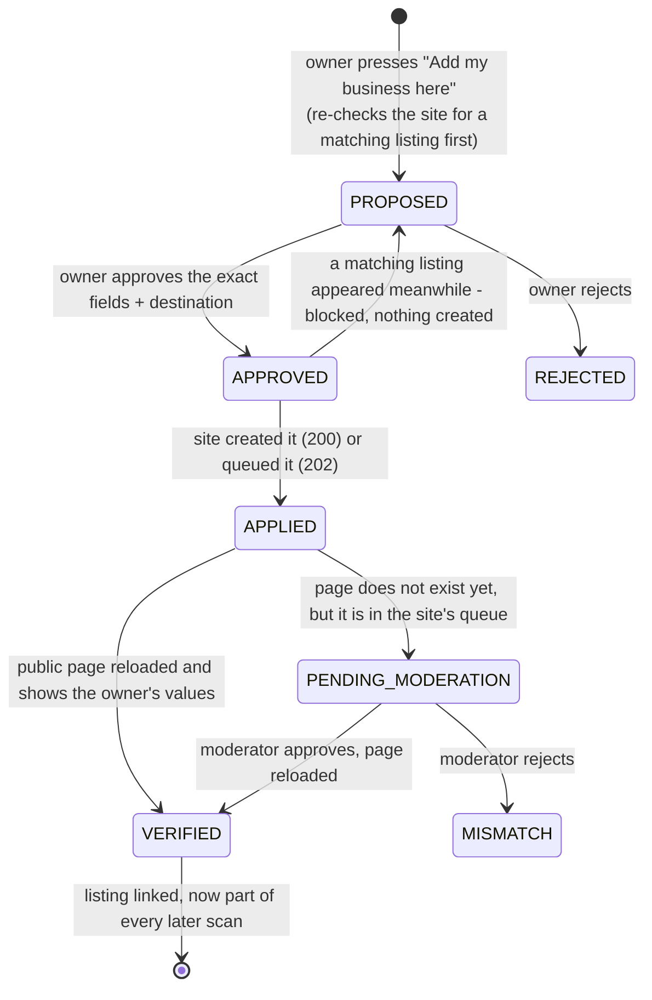
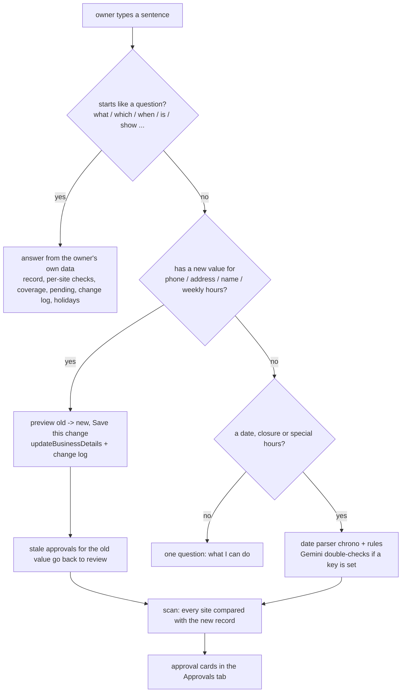

# Architecture

One deployable Node service: Express API + built React console + five mock listing sites (`/mock/<site>/`) + SQLite.
All examples below use the real seeded data (fictional "Sunrise Sweets & Bakery", `biz_sunrise_001`).

## 1. Workflow



## 2. Per-field state machine


Transitions live in `src/core/states.ts`; entering `APPROVED` requires actor `owner`, entering `VERIFIED` requires actor `verifier` (tests: `tests/states.test.ts`).

## 3. Planner + guardrail flow


Guardrails (`src/agent/guard.ts`, `tools.ts`): `apply_approved` only for DB-`APPROVED` fields; permission denied ⇒ `flag_listing` forced; scan-phase tools cannot apply; `flag_listing` only when permission was denied; `reload_and_verify` only when something was applied; any listing ID other than the registered one is blocked; only the verifier moves a field to `VERIFIED`.

## 4. Normalisation examples (real data)

| Field | Raw on site | Normalised | vs. record | Result |
|---|---|---|---|---|
| Phone (site C) | `090000 00001` | `+919000000001` | `+919000000001` | FORMAT_ONLY_EQUIVALENT |
| Phone (site D) | `+91 90000 00099` | `+919000000099` | `+919000000001` | MISMATCH → FLAGGED (not owner) |
| Address (site C) | `42 Marigold Ln., Koregaon Park, Pune, MH - 411001` | `42 marigold lane koregaon park pune maharashtra 411001` | same string | FORMAT_ONLY_EQUIVALENT |
| Hours (site B) | `Mon–Sat: 09:00–21:00 / Sun: 10:00–14:00` | `Mon-Sat 09:00-21:00; Sun 10:00-14:00` | same | MATCH (24 h grouped) |
| Hours (site A) | `Monday: 9:00 AM – 9:00 PM …` (7 rows) | `Mon-Sat 09:00-21:00; Sun 10:00-14:00` | same | MATCH (12 h per-day table) |
| Hours (site E) | `Sun: Closed` | `…; Sun closed` | `Sun 10:00-14:00` | MISMATCH → PROPOSED → PENDING_MODERATION |
| Holiday (site B) | `2026-11-08 (Diwali) · Closed` | `2026-11-08..2026-11-08 closed` | `…special 10:00-14:00` | MISMATCH → VERIFIED after fix |



## 5. Entity identity and decoy handling


The decoy exists on all five sites with a different ID, address, phone and hours. Tests assert it is never written to (`LST-*-2002` has 0 entries in the mock write log).

## 6. Add-on flow: Holiday Foresight


Field-level mismatches (which site shows what) are not shown on the Holidays tab: they live in the scan, Approvals and Consistency tabs. Days inside a longer closure typed in Edit & Ask are read-only here.

## 7. Add-on flow: plain-language closures


Example: "we are closed on 26th December" (today 2026-10-21) → Closed · Sat 26 Dec 2026 → Confirm → proposals on A, B, C, E, flag on D → approved sites VERIFIED, E PENDING_MODERATION (TC5).

## 8. Failure handling

| Failure | What happens | Where |
|---|---|---|
| No API key / `LLM_PROVIDER=none` | Deterministic planner and template summary; everything works | `service.ts` |
| Gemini 429 | One retry after back-off, then step falls back (badge Fallback) | `llm.ts` |
| Gemini timeout (8 s) | Step falls back | `llm.ts` |
| Gemini invalid JSON / Zod failure / unknown tool | Step falls back; nothing executed | `llm.ts`, `geminiPlanner.ts` |
| Model 404/unsupported | Try the other configured model, then fall back | `llm.ts` |
| Gemini suggests an unsafe action | Blocked or forced to flag; deterministic planner continues (badge Blocked) | `guard.ts`, `loop.ts` |
| Playwright cannot launch | `READER_MODE=auto` silently uses HTTP + cheerio | `reader.ts` |
| Page shows a different listing ID | `IDENTITY_MISMATCH`, platform skipped, no edit | `tools.ts` |
| Dashboard says permission denied / HTTP 403 on write | Field → `FLAGGED_NOT_OWNER` | `tools.ts` |
| Moderation queue | `PENDING_MODERATION` until reload shows the value | `tools.ts` |
| Edit sent but page never changes and nothing queued | Back to `MISMATCH` with a reason | `tools.ts` |
| Same step re-run | Read-before-write skips an already-correct value; only `APPROVED` rows are sent, so no double apply | `tools.ts` |
| Free host restarts, SQLite wiped | App reseeds on boot | `seed.ts`, `server/index.ts` |
| Another run in progress | API returns 409 | `app.ts` |

---

# Multi-business access, onboarding and PIN login

## 9. Login and tenant isolation

```mermaid
sequenceDiagram
  participant B as Browser
  participant S as Server
  participant DB as SQLite
  B->>S: POST /api/auth/login {pin}
  S->>S: rate-limit check (5 failures per IP, then cool-down)
  S->>S: normalise PIN, HMAC-SHA256(PIN_SECRET, PIN)
  S->>DB: SELECT business WHERE pin_hmac = hmac
  S->>S: constant-time compare, one generic "Invalid PIN." on any failure
  alt pending business (first login)
    S->>S: activate: claim + link the confirmed listings
  end
  S->>DB: store sha256(random session id) -> business uid
  S-->>B: Set-Cookie sid (httpOnly, SameSite=Lax, Secure over https)
  B->>S: any /api/... request with the cookie
  S->>S: requireAuth -> req.biz (uid); every query takes that uid
```

- Every store/agent/report function takes the business id as a **required argument** (no "current business" default), so a missing uid is a compile error, not a data leak. Rows in `field_states`, `exceptions`, `platform_listings`, `runs`, `trace`, `audit_log`, `site_matches` carry `business_id`.
- Looking up someone else's field id answers **404** exactly like a missing one (`getOwnedField`).
- Global operations (reset, `/tests`, evidence) require the demo business.
- The mock listing sites accept dashboard reads/edits only with a **server-signed delegated credential** (`x-mock-account` + HMAC token), simulating the owner's login on a real platform.

## 10. New-owner onboarding



Score examples (real, from the seeded data):

| Entered | Listing | phone | address | name | Score | Decision |
|---|---|---|---|---|---|---|
| Sunrise Sweets & Bakery … +91 90000 00001 | the true Sunrise listing | 40 | 35 | 25 | **100** | claimed by another account → flagged |
| same | look-alike *Sunrise Sweet House* (17 Maple Road, +91 90000 00077) | 0 | 18 | 19.7 | **37.7** | below LOW → no match |
| same | Sunrise listing with an old phone | 0 | 35 | 25 | **60** | between LOW and HIGH → owner chooses |
| Green Leaf Cafe … +91 90000 00031 | *Green Leaf Café*, `8 Lotus St., Baner, Pune, MH - 411045`, `090000 00031` | 40 | 35 | 25 | **100** | strong match |
| same | look-alike *Green Leaf Cafe & Bakery*, Kothrud, +91 90000 00032 | 0 | 8.2 | 22.4 | **30.6** | below LOW → no match |

## 11. Add my business to a site where it is not listed



## 12. Added failure handling

| Failure | What happens | Where |
|---|---|---|
| Wrong, malformed or empty PIN | same generic "Invalid PIN."; counted toward the lock-out | `server/auth.ts` |
| 5 wrong PINs from one client | 429 with Retry-After; even the right PIN is refused during the cool-down | `auth/limiter.ts` |
| Browser sends a business's field id belonging to another business | 404, nothing changes | `core/store.ts` `getOwnedField` |
| Another origin posts to the API | 403 | `server/auth.ts` `sameOrigin` |
| Site cannot be read during matching | reported, nothing matched or created there | `onboarding/discover.ts` |
| Best match is claimed by another account | flagged, cannot be confirmed, no duplicate may be created | `onboarding/score.ts`, `agent/createListing.ts` |
| Two owners confirm the same listing | the first login claims it; the second is told it was taken and it is not linked | `onboarding/service.ts` |
| PIN page refreshed before it was saved | the business was still pending: it expires unused and onboarding can be redone | `onboarding/service.ts` |
| A matching listing appears after "Add my business" was approved | blocked right before sending; nothing created | `agent/createListing.ts` |
| Moderator rejects a created listing | card goes back to a failed state (never "verified"); the owner may ask again | `agent/createListing.ts` |


---

# Console tabs and the text box

## 13. Text box routing


Questions and detail edits never leave the server (only date requests may be cross-checked by a model).

## 14. What each tab reads

| Tab | Data it uses |
|---|---|
| My Details, Listings & Sites, Approvals, Consistency | `GET /api/state` (record, coverage, matches, report rows), approvals via `/api/fields/:id/approve|reject`, `/api/platforms/:id/approve-all` |
| Edit & Ask | `POST /api/nl/preview|refine|confirm`, `GET/PUT /api/business`, `POST /api/exceptions/:id/cancel` |
| Change Log | `GET /api/changelog` (change_log table + audit_log, newest first) |
| Agent Trace | `GET /api/trace` (latest run, or `?all=1` incl. login and older runs) |
| Holidays | `GET /api/foresight`, `POST /api/foresight/:id/accept` |
| Add Business | the public `/api/onboarding/*` routes, then `/api/auth/login` with the new PIN (switches business) |

Every endpoint is scoped to the logged-in business; the tab never sends a business id.
