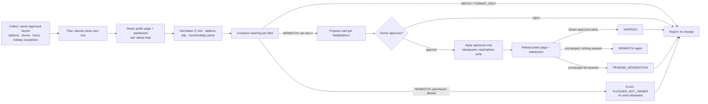
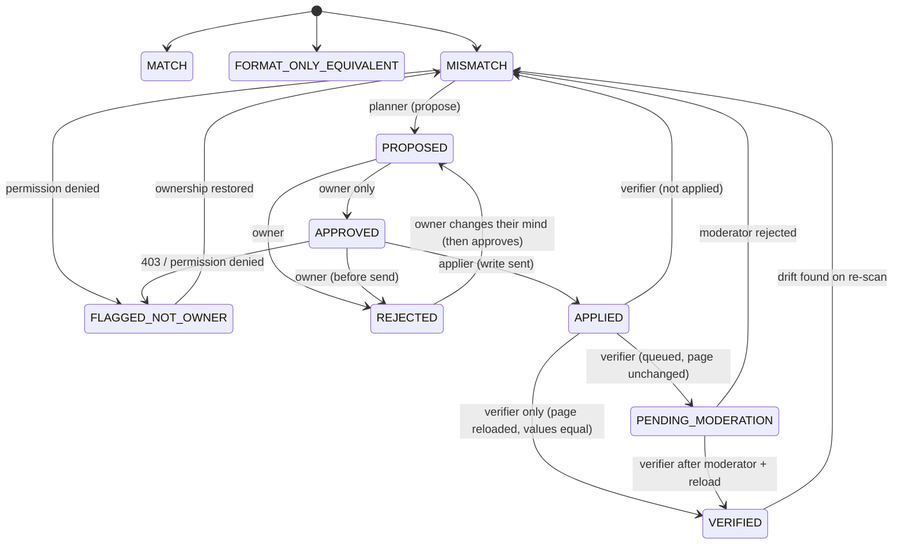
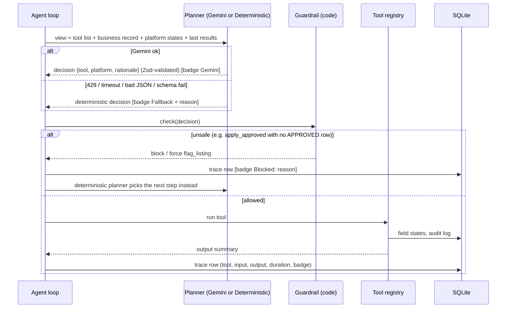
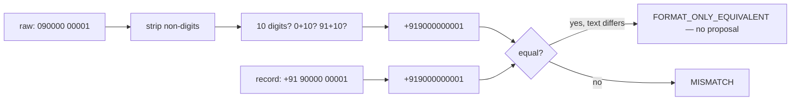
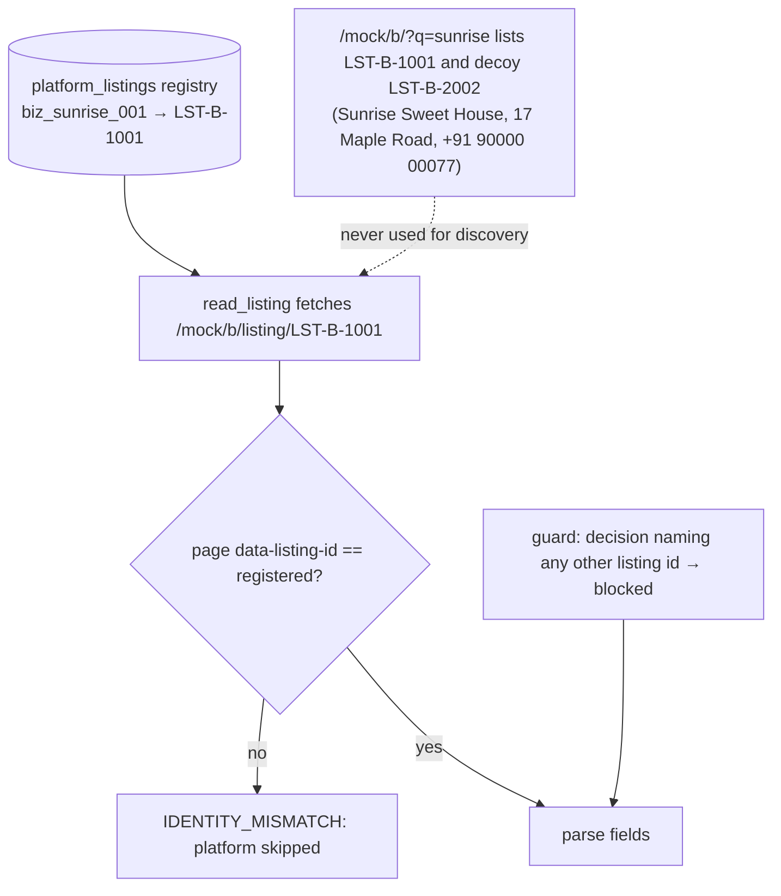
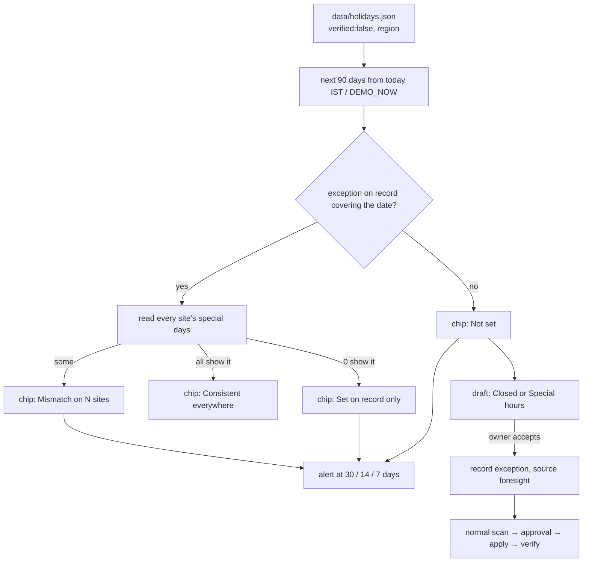
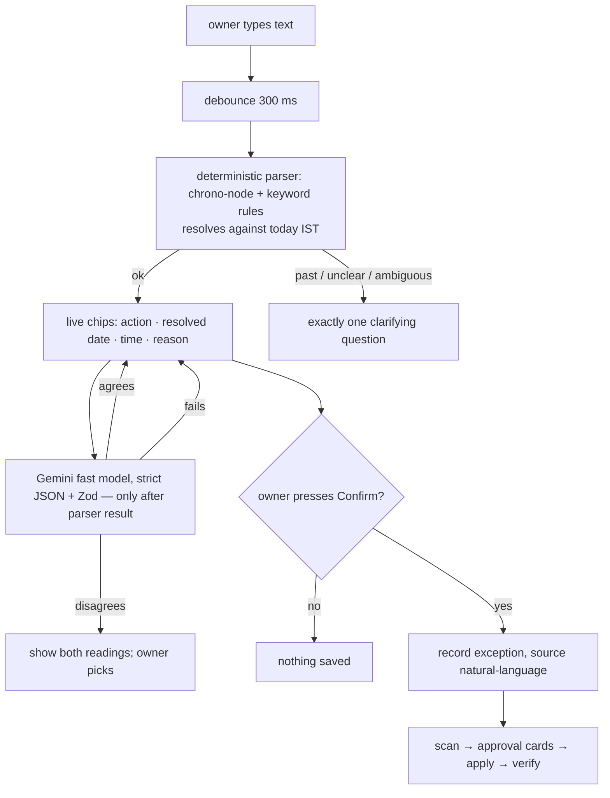

# Architecture

One deployable Node service: Express API + built React console + five mock listing sites (`/mock/<site>/`) + SQLite.
All examples below use the real seeded data (fictional "Sunrise Sweets & Bakery", `biz_sunrise_001`).

## 1. Workflow

## 2. Per-field state machine

Transitions live in `src/core/states.ts`; entering `APPROVED` requires actor `owner`, entering `VERIFIED` requires actor `verifier` (tests: `tests/states.test.ts`).

## 3. Planner + guardrail flow

Guardrails (`src/agent/guard.ts`, `tools.ts`): `apply_approved` only for DB-`APPROVED` fields; permission denied ⇒ `flag_listing` forced; scan-phase tools cannot apply; `flag_listing` only when permission was denied; `reload_and_verify` only when something was applied; any listing ID other than the registered one is blocked; only the verifier moves a field to `VERIFIED`.

## 4. Normalisation examples (real data)

| Field | Raw on site | Normalised | vs. record | Result |
|---|---|---|---|---|
| Phone (site C) | `090000 00001` | `+919000000001` | `+919000000001` | FORMAT_ONLY_EQUIVALENT |
| Phone (site D) | `+91 90000 00099` | `+919000000099` | `+919000000001` | MISMATCH → FLAGGED (not owner) |
| Address (site C) | `42 Marigold Ln., Koregaon Park, Pune, MH - 411001` | `42 marigold lane koregaon park pune maharashtra 411001` | same string | FORMAT_ONLY_EQUIVALENT |
| Hours (site B) | `Mon–Sat: 09:00–21:00 / Sun: 10:00–14:00` | `Mon-Sat 09:00-21:00; Sun 10:00-14:00` | same | MATCH (24 h grouped) |
| Hours (site A) | `Monday: 9:00 AM – 9:00 PM …` (7 rows) | `Mon-Sat 09:00-21:00; Sun 10:00-14:00` | same | MATCH (12 h per-day table) |
| Hours (site E) | `Sun: Closed` | `…; Sun closed` | `Sun 10:00-14:00` | MISMATCH → PROPOSED → PENDING_MODERATION |
| Holiday (site B) | `2026-11-08 (Diwali) · Closed` | `2026-11-08..2026-11-08 closed` | `…special 10:00-14:00` | MISMATCH → VERIFIED after fix |

## 5. Entity identity and decoy handling

The decoy exists on all five sites with a different ID, address, phone and hours. Tests assert it is never written to (`LST-*-2002` has 0 entries in the mock write log).

## 6. Add-on flow: Holiday Foresight

Readiness (0-100) for the next holiday = 40 (exception on record) + 40 × (sites correct ÷ sites) + 20 (nothing flagged/pending; 10 if pending; 0 if flagged). Seeded Diwali: 40 + 32 + 20 = 92 (site B wrong).

## 7. Add-on flow: plain-language closures

Example: "we are closed on 26th December" (today 2026-10-21) → Closed · Sat 26 Dec 2026 → Confirm → proposals on A, B, C, E, flag on D → approved sites VERIFIED, E PENDING_MODERATION (TC5).

## 8. Failure handling

| Failure | What happens | Where |
|---|---|---|
| No API key / `LLM_PROVIDER=none` | Deterministic planner and template summary; everything works | `service.ts` |
| Gemini 429 | One retry after back-off, then step falls back (badge Fallback) | `llm.ts` |
| Gemini timeout (8 s) | Step falls back | `llm.ts` |
| Gemini invalid JSON / Zod failure / unknown tool | Step falls back; nothing executed | `llm.ts`, `geminiPlanner.ts` |
| Model 404/unsupported | Try the other configured model, then fall back | `llm.ts` |
| Gemini suggests an unsafe action | Blocked or forced to flag; deterministic planner continues (badge Blocked) | `guard.ts`, `loop.ts` |
| Playwright cannot launch | `READER_MODE=auto` silently uses HTTP + cheerio | `reader.ts` |
| Page shows a different listing ID | `IDENTITY_MISMATCH`, platform skipped, no edit | `tools.ts` |
| Dashboard says permission denied / HTTP 403 on write | Field → `FLAGGED_NOT_OWNER` | `tools.ts` |
| Moderation queue | `PENDING_MODERATION` until reload shows the value | `tools.ts` |
| Edit sent but page never changes and nothing queued | Back to `MISMATCH` with a reason | `tools.ts` |
| Same step re-run | Read-before-write skips an already-correct value; only `APPROVED` rows are sent, so no double apply | `tools.ts` |
| Free host restarts, SQLite wiped | App reseeds on boot | `seed.ts`, `server/index.ts` |
| Another run in progress | API returns 409 | `app.ts` |
